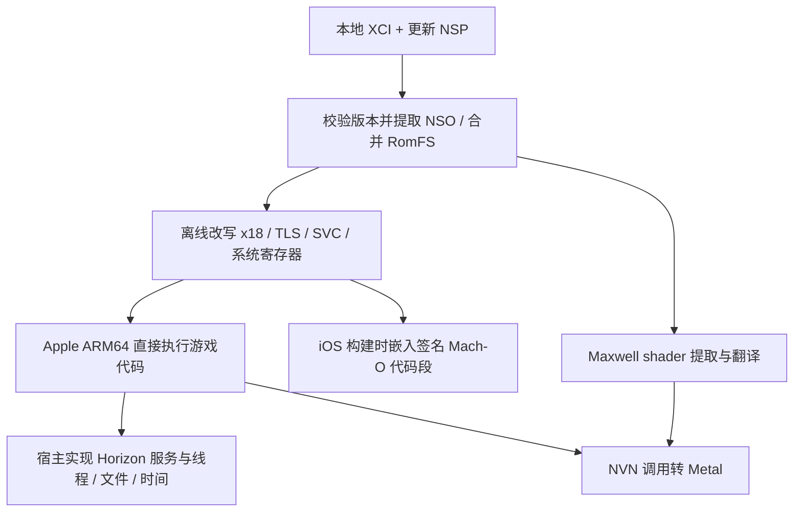

# ACNH 移植至 Apple Silicon Mac / iPhone：研究与可行性评估

日期：2026-10-21。目标游戏为 Switch《集合啦！动物森友会》（ACNH）。本报告结合三个项目的固定提交源码，以及用户提供的本地游戏文件做判断。用户已分别运行三个参考项目；本轮没有运行 ACNH，也没有生成 ACNH 移植 App。

**建议采用 MacNativeGames 单一基座，走 ARM64 机器码离线改写 + Horizon 系统兼容层 + NVN→Metal 的路线。先完成 Mac 离线单机闭环，再移植到 iPhone。现有证据足以支持开展原型，尚不足以承诺完整可玩、性能或交付工期。**

这条路线无需先完整反编译 ACNH。前次只围绕传统模拟器和反编译搜索，遗漏了本次三个项目所用的直接执行路线；以下以实际源码和 ACNH 样本纠正该判断。

## 1. 三个项目真正做了什么

Switch 与 Apple Silicon 都使用 AArch64，但相同指令集不等于能直接启动。三个项目共同解决的是寄存器约定、系统调用、线程/TLS、地址空间、系统服务和 GPU 接口的差异。这里的“原生”指游戏 CPU 机器码经必要改写后在 Apple CPU 上执行；图形和操作系统接口仍需要兼容层。

| 项目与研究提交 | 适合借鉴的部分 | 对 ACNH 的具体限制 | 建议定位 |
| --- | --- | --- | --- |
| [Mush8：975040b](https://github.com/c22dev/mush8/tree/975040ba341efb99c5631292a0266ae26b28d960) | Rust 离线改写器、不可安全改写时拒绝继续、Unicorn 差分验证、NVN/Metal 与 shader 管线 | 绑定 MK8D 4.0.1 的模块/driver 布局；当前 NSO 解析器拒绝 RELR，而 ACNH 3.0.0 四模块都使用它；另有 DT_HASH 假设 | 借鉴改写验证方法；不选为首个基座 |
| [MacNativeGames：dfa7ec4](https://github.com/ly05010419/MacNativeGames/tree/dfa7ec426f8b37798073a108ede1504c827d8af0) | 从提取、改写、服务、NVN/Metal、shader 到 Mac/iOS 打包的链路；已有 TOTK→BOTW 第二标题接入；已有 RELR 支持 | TOTK/BOTW 版本地址、补丁和构建分支仍很多；ACNH 服务和图形语义未适配；存在有条件的 GNU-only 符号计数缺口 | **唯一宿主基座，建立 ACNH 独立入口** |
| [D2R Mobile：53e7c5b](https://github.com/jhaizhou-ops/d2r-mobile/tree/53e7c5bb9ca3ea53e2160005be8fbe920cd9cb53) | iOS 生命周期、触屏/手柄、存档故障恢复、性能与故障采样；ARM64 改写与服务分层 | 游戏内部 Hook、私有 SVC、图形补丁及输入规则绑定 D2R；不能直接套入 ACNH | 定点借鉴 iOS 与验证经验 |

源码细读记录分别见 [Mush8](sources/mush8.md)、[MacNativeGames](sources/macnativegames.md)、[D2R Mobile](sources/d2r-mobile.md)。这些记录只评价各自固定提交，不把项目说明或用户跑通其他游戏当作 ACNH 已兼容。

选择 MacNativeGames 的主要理由是**第二标题接入经验、现成的 RELR 链路，以及本轮 ACNH shader 采样与其工具链相容**。它本来就沿用 D2R 的部分底层工作，再拼入另一套完整 runtime 会让线程、地址空间和图形对象出现两套约定。应建立 `games/acnh`，只在确有共用需求时抽离底层接口，不先重构成通用 Switch 平台。[第三方来源说明](https://github.com/ly05010419/MacNativeGames/blob/dfa7ec426f8b37798073a108ede1504c827d8af0/THIRD_PARTY_NOTICES.md)、[第二标题构建分支](https://github.com/ly05010419/MacNativeGames/blob/dfa7ec426f8b37798073a108ede1504c827d8af0/build_app.py#L1050-L1095)。

许可证会影响后续代码组合方式：Mush8 为 GPL-3.0，不能把它当成 MIT 代码直接混入而忽略义务；MacNativeGames/D2R 的许可证和各自第三方组件也须保留。当前建议主要借鉴 Mush8 的验证方法，是否直接复用代码在实施时单独决定。[Mush8 LICENSE](https://github.com/c22dev/mush8/blob/975040ba341efb99c5631292a0266ae26b28d960/LICENSE)。

## 2. 你的 ACNH 文件已经验证到哪一步

### 输入与版本

| 项目 | 本轮结果 | 边界 |
| --- | --- | --- |
| XCI | 容器可读；Control NACP 显示 **1.0.0**；程序 Title ID `01006F8002326000` | 未做全 RomFS IVFC 校验 |
| 更新 NSP | Control NACP 显示 **3.0.0**；更新元数据 Title ID `01006F8002326800` | 尚未完成 BKTR 更新资源合并和整包安装验证 |
| 两版 ExeFS | 均提取 `main`、`rtld`、`sdk`、`subsdk0`、`main.npdm`；FS header、ExeFS hash table 和全部 ExeFS 数据块校验通过 | 未验证 NCA RSA 签名 |
| 八个 NSO | 全部 `.text/.rodata/.data` 解压并与 NSO 头 SHA-256 一致，共 24 段 | 不是代码改写或执行验收 |
| 密钥文件 | 原文件是 GitHub HTML 保存页；已从其文本在内存恢复键值并成功解析游戏 | 原文件未修改；没有打印或另存密钥 |

3.0.0 CNMT 中有 11 个内容记录，当前更新包提供 3 个内容及元数据；另 8 个记录类型为 delta fragment，不能仅据其未随包出现就判定损坏。当前同样不能宣称更新资源链已完整验证。

建议**锁定 3.0.0 为产品目标**，1.0.0 留作差分和启动诊断。若为缩短首帧实验先运行 1.0.0，结果只计入该版本；禁止把 3.0.0 代码配上未合并的 1.0.0 资源当成正式实现。

### 指令、重定位与 SDK 格式

- 两版均为 AArch64；`main` 的 `.text` 从 35,723,872 B 增至 66,081,456 B。不能从这些字节数直接推导 RAM、FPS 或开发工时。
- 3.0.0 四模块使用 RELR：`main` 373,220、`rtld` 39、`sdk` 15,005、`subsdk0` 3,424，共 **391,688** 个展开目标。全部位于 `.data`；两版已解析的 RELA/JMPREL/RELR 都没有 `.text/.rodata` 目标。这对 iOS 签名代码段方案是有利证据。
- 不仅检查了格式：把 MNG 现有 `decode_relr` 用于实际 3.0.0 四模块，目标逐项与独立解析器一致，隐式 addend 边界检查通过；上游 RELR 单测 **5/5** 通过。但尚未验证最终 loader 布局和运行。
- 更新版 `rtld/sdk/subsdk0` 只有 GNU hash，无 `DT_HASH`。MNG 的 `prepare_modules.py` 与 `prepare_runtime.py` 已从 NSO dynsym 字段回退计数；残留问题在 `patch_nso.py:774`：**若进入 `if calls:` 的 call-window 检查，仍直接访问 `tags[4]`**。应把同样的有界回退接到这里并测试，不能概括为整个 MNG 不支持 GNU-only，也不能跳过安全检查。
- 两版 `main/subsdk0` 都导入 `nvnBootstrapLoader`，`sdk` 有对应导出，为拦截 NVN 入口提供线索。具体调用、API 覆盖和对象布局仍需 ACNH 运行轨迹。

上述源码边界见 [MNG RELR](https://github.com/ly05010419/MacNativeGames/blob/dfa7ec426f8b37798073a108ede1504c827d8af0/games/totk/third_party/d2r/relr.py)、[GNU-only 回退](https://github.com/ly05010419/MacNativeGames/blob/dfa7ec426f8b37798073a108ede1504c827d8af0/games/totk/scripts/prepare_modules.py#L72-L80)、[有条件的遗留访问](https://github.com/ly05010419/MacNativeGames/blob/dfa7ec426f8b37798073a108ede1504c827d8af0/games/totk/third_party/d2r/patch_nso.py#L763-L781)、[Mush8 RELR 拒绝](https://github.com/c22dev/mush8/blob/975040ba341efb99c5631292a0266ae26b28d960/crates/nxfs/src/module.rs#L83-L90)。完整模块画像见 [二进制分析](acnh-binary-profile.md)。

### Shader：已做真实翻译与双平台编译采样

对 **1.0.0** RomFS 只读枚举 66,790 个文件，找到 16 个 shader 路径候选。三个主要包均可由现有解压/解析代码识别：

| 包 | 解包结构 | 当前解析器识别的包内唯一 key 数 |
| --- | --- | ---: |
| `Park_Proc` | Yaz0 → SARC → BAHS | 71 |
| `Park_UBER_All` | Yaz0 → SARC → FSHA/BNSH | 3,363 |
| `apkg` | Yaz0 → SARC → FSHA/BNSH | 16 |

这些数没有跨包去重，也没有覆盖字体、系统 shader 和运行时状态变体，不能当成全游戏 shader 总数。

使用已核对 SHA-256 的 MNG `totk_xlate`，从每包每 stage 选最长/最短代码候选，去重后测试 13 个：

| 检查 | 结果 |
| --- | --- |
| Maxwell → SPIR-V/MSL | **12 成功，1 失败** |
| 成功样本 → macOS Metal 编译、metallib 链接 | **12/12 通过** |
| 同一批样本 → iOS Metal 编译、metallib 链接 | **12/12 通过** |

失败项是 `Park_Proc` 启发式解析得到的 **1 字节顶点 shader 候选**，翻译器报 `IndexOutOfRangeException`。尚不能判断是占位记录、解析误命中还是其他格式问题，必须追查，不能直接剔除后宣称全通过。

这是一项正面证据：ACNH 的一部分现成 shader 能通过候选图形工具链。但样本有意选择极值，非随机抽样；绑定参数使用默认假设，未执行 GPU、未验证画面/反射/同步，且未测试合并后的 **3.0.0** shader。**不能把 12/13 换算成全游戏兼容率。**

## 3. 建议的 ACNH 方案

| 层 | 实施方向 | 不能照搬的部分 |
| --- | --- | --- |
| 构建与版本 | 为 ACNH 建独立 title/version profile、模块散列、原字节断言、生成物清单；先补 3.0.0 BKTR 合并 | TOTK/BOTW 地址表、游戏内部补丁和 shader 清单 |
| CPU 与装载 | 复用 MNG 离线改写、模块装载、SVC/TLS/线程基础；逐模块验证改写结果；引入差分检查方法 | 未知指令默认跳过、运行时临时修改 iOS 签名代码页 |
| Horizon 服务 | 记录真实 SVC/IPC；按需补 FS、账户、时间、字体、键盘、音频/媒体等 | 把所有未知命令都返回成功，或从 NPDM 授权列表直接认定调用覆盖 |
| 图形 | 接 ACNH NVN bootstrap，核对驱动函数布局、纹理/缓冲/同步；Mac 先采集真实 shader 状态，再形成 iOS 种子集 | MK8D/TOTK 固定 driver 表、仅凭 shader 编译通过认定画面正确 |
| Mac 前端 | 原生窗口、手柄、诊断、可隔离的新测试岛；先形成完整单机流程 | 首帧出现即宣称可玩 |
| iPhone 前端 | 构建时嵌入改写代码，签名安装；触控/手柄、系统输入、前后台和存档协调 | 把 Mac 成功视为 iOS ABI、地址空间与内存已解决 |

ExeFS 有四个模块，不代表四个都必须被宿主执行。MNG 当前改写/打包的是 `main/subsdk0/sdk`，其 `rtld` 用于静态盘点；ACNH 应根据入口和宿主装载方案确认实际执行集合。本轮对四模块做完整哈希、符号与重定位检查，是输入盘点，不是已决定复用原 `rtld`。

**CPU 与 GPU 的限制需要分开。** iOS 的 CPU 动态代码和签名限制，是预先改写并嵌入 Mach-O 的原因。iOS Metal 可以在运行时从 MSL 源码创建 library；现有 MNG iOS 包没有携带桌面的 C# shader translator，因此离线翻译/AOT 种子是本方案的工程选择，也能减少首次遇到 shader 时的卡顿，并非 iOS 禁止运行时编译 GPU shader。[Apple API](https://developer.apple.com/documentation/metal/mtldevice/makelibrary(source:options:))、[Apple Metal 编译说明](https://developer.apple.com/videos/play/wwdc2023/10127/)。

初版沿用 MNG 的 Metal 4 路径及 macOS/iOS 26 平台要求，避免同时承诺旧系统兼容；本机 arm64、macOS 27.2、Xcode 27.0 满足这部分构建条件。实施中用户已指定 iPhone 17 Pro Max、iOS 27.2，并确认具有苹果开发者会员；可用内存、实际签名安装及地址空间能力仍需真机核验，不能仅凭 Switch 的内存规格推断（见[实施记录](../implementation/acnh-macos-plan.md)）。[基座平台说明](https://github.com/ly05010419/MacNativeGames/blob/dfa7ec426f8b37798073a108ede1504c827d8af0/README.md#L78-L125)。

## 4. ACNH 最容易被低估的工作

1. **时间与跨天。** 本地时间、UTC、时区、单调计时和休眠恢复要分开实现；测季节、跨午夜、跨日和 iOS 后台恢复。ACNH 的现实时间玩法决定这些是主功能。[Nintendo 玩法说明](https://animalcrossing.nintendo.com/new-horizons/explore/)。
2. **岛存档与账户。** 一台主机共享一座岛，居民与账户有对应关系；不能套用“每用户一个完全独立岛目录”的简单模型。以真实 FS 打开/commit 轨迹确认 system save/account save 关系；先做全新测试岛、多文件一致性、快照与中断恢复。原岛导入和 Switch 回写另行评估。[Nintendo 新游戏说明](https://www.nintendo.com/en-gb/Support/Purchases-Subscriptions/Games/How-to-Start-a-New-Game-Animal-Crossing-New-Horizons--1747986.html)。
3. **命名与中文输入。** `swkbd`、Unicode、输入法组合、长度、取消/确认需要真实测试，不能用固定名字绕过后就认定完成。人物名、岛名和生日存在不可随意更改的确认流程。[Nintendo 新游戏说明](https://www.nintendo.com/en-gb/Support/Purchases-Subscriptions/Games/How-to-Start-a-New-Game-Animal-Crossing-New-Horizons--1747986.html)。
4. **图形、音频与场景覆盖。** 室内外、水面、透明物、天气、昼夜、菜单/字体、开场媒体、音轨和解码接口均须实测；不能凭 ACNH 画面看起来比 TOTK 简单推断工作量更小。
5. **网络模式。** 首版只做单用户本机离线。局域无线、同机多人和在线是不同路径；真 Switch 互通、Nintendo Online、DLC/HHP 和原岛迁移都不能自动包含在主线中。[Nintendo 多人说明](https://en-americas-support.nintendo.com/app/answers/detail/a_id/49136/)。

## 5. 分阶段验收与可行性判断

| 阶段 | 具体交付 | 验收门禁 |
| --- | --- | --- |
| A：补齐格式与改写预检 | 3.0.0 代码/资源一致输入；GNU-only 检查修补；ExeFS 四模块完整盘点，确定实际执行模块并生成其改写清单 | 所有拒绝项有解释；补丁含原字节校验；重定位和符号未静默漏项；改写差分验证通过 |
| B：Mac 真实首帧 | ACNH 独立入口、loader/线程/IPC/NVN 最小路径与诊断 | 真实进程启动并提交首帧；能列出触达的未实现服务/图形调用；不以默认成功桩掩盖错误 |
| C：Mac 离线可玩闭环 | 新岛创建→中文命名→保存→完全退出→重启→跨天 | 多轮读写一致、可回滚；代表场景画面对拍；shader miss、服务缺口、内存峰值可量化；独立审查通过 |
| D：iPhone | 签名代码段、shader 种子集、输入、生命周期与资源控制 | 指定真机首次全新安装启动、命名/存档、前后台/锁屏、中断恢复及持续游玩；测内存/热量/帧时 |
| E：可选范围 | 多用户、DLC、局域通信、原岛导入等逐项扩展 | 各自独立端到端验证，不随主线自动完成 |

**Mac：值得投入一个有时间边界的原型，主路线有具体依据。** 输入、模块格式、重定位和部分 shader 工具链已经得到本地证据支持；真正决定后续投入的是首帧与新岛存读档路径上还差多少 Horizon/NVN 语义。

**iPhone：有可落地的候选架构，但可行性有条件。** 数据段重定位结果支持预签名代码方案，shader 的 iOS 编译也已有样本通过；CPU 改写、虚拟地址、实际内存、签名、GPU 运行正确性和后台恢复仍没有 ACNH 真机证据。

当前不报成功概率、人月或 FPS。先给 A/B 阶段安排短期原型，依据真实失败清单再估 C/D 的投入。如果遇到无法等价改写的必需代码、无法满足的 iOS CPU 签名/地址空间条件、不可承受的设备内存，或必需服务绑定无法重现的远端状态，应停下重估；如果图形缺口只是零散函数/格式问题，则逐项补齐。**目前未发现足以直接否决路线的静态证据，也尚未证明路线最终成功。**

## 6. 证据与复核入口

- [架构详稿](acnh-architecture.md)：分层设计、替代路线、ACNH 专项风险与停止条件。
- [二进制画像](acnh-binary-profile.md)：Build ID、段哈希、符号、RELR、NPDM 及方法边界。
- [可保存的结构化证据](evidence/acnh-static-summary.json)：固定源码提交、样本与编译结果、失败项、实际 RELR 交叉检查。
- [三项目源码笔记](sources/macnativegames.md)：另见同目录 Mush8 和 D2R 笔记，附固定提交链接。

本地详细工件位于已忽略的 `work/research/`：`profile/analyze_nso.py`、`profile/nso-profile.json`、`profile/check_upstream_relr.py`、提取 manifest、RomFS 索引和 shader 编译记录。分析器通过本机 liblz4 解压；RELR 交叉检查及资源诊断脚本引用 `/tmp/acnh-port-research-20261021/` 下的固定提交 checkout，异机复核须先取得相同源码并调整该路径。它们是研究工件，不是已经产品化的构建工具。

CodeGraph 在这些 checkout 不可用或为空，因此使用了定向源码检索与实际文件解析。未安装新依赖、未启动 ACNH、未更改游戏及密钥原件，未提交或推送。`.gitignore` 已排除游戏、keys 和提取/编译产物，文档仅保留分析与摘要。
